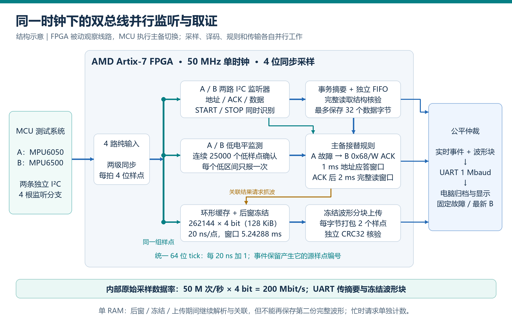

# I²C Sentinel · FPGA 双路 I²C 总线异常分析仪

四路50MSa/s同步采样，20ns统一时基，262144点环形缓存；双路协议解析、低电平监测、故障关联与BRAM并行工作。MCU执行主备读取，FPGA旁路监听，电脑显示、归档和重放。200Mbit/s为内部采样位流；UART为1Mbaud，上传事件与冻结波形。

**English introduction**

I²C Sentinel is an FPGA-based dual-bus I²C anomaly analyzer built on the AMD Artix-7 platform. It synchronously samples four channels at 50 MSa/s per channel, providing 20 ns time resolution. FPGA hardware parallelism enables simultaneous protocol decoding, anomaly detection, fault correlation, and waveform buffering across both buses. By passively monitoring bus activity, the system detects address NACKs and SCL-low timeouts and verifies MCU-controlled failover between primary and backup devices. A companion PC application provides waveform visualization, event logging, and offline replay to support bus fault diagnosis and communication reliability verification.

本包于2026年10月27日同步上位机最新故障自动跟随修复，新增4项回归；当前31项单元及配套检查见[更新与验证](docs/pc_update_20261027.md)。

## 阅读入口

- [设计报告与实测图](report/design_report.md)
- [实现说明](docs/design.md) · [04协议](docs/protocol_04.md)
- [数据与证据索引](report/evidence_index.md) · [仿真结果](sim/results/README.md)
- [AI协作精选](report/ai_collaboration.md) · [176条对话正文](report/ai_conversations.md) · [可复用Skill](skill/README.md)

## 系统架构

MCU负责访问A路MPU6050、B路MPU6500并执行主备切换；FPGA通过四根只输入的监听线观察两条I²C总线。电脑接收FPGA的事件与冻结波形，完成校验、显示、归档及离线回放。



FPGA内部使用同一个50MHz时钟。四路输入经过两级同步后，每20ns产生一组4位样点，同时送入以下并行通路：

- **双路协议解析：** A、B各有独立的I²C监听器，同时识别START、地址、ACK/NACK、数据和STOP，并生成事务摘要。
- **异常与关联判断：** 低电平检测与协议解析同时运行；关联规则以统一的源样点时间检查A故障后B地址应答是否在1ms内，以及应答后是否在2ms内完成规定的14字节读取。
- **原始波形缓存：** BRAM环形缓存持续记录同一组样点，容量为262144×4bit（128KiB），对应5.24288ms窗口；接受抓拍请求后收齐后窗，再冻结上传。

实时事件通过独立FIFO排队，与冻结波形块共同送入仲裁和1Mbaud UART。上传期间协议解析与规则判断仍运行；单块波形RAM在后窗、冻结和上传期间不能接纳第二份完整捕获，未保存的抓拍请求单独计数。200Mbit/s是FPGA内部采样位流，串口传输的是事件和冻结波形。模块连接与接口细节见[实现说明](docs/design.md)。

## 目录结构与赛题对照

本仓库按FPGA、MCU、电脑端及验证材料细分目录。以下目录树展示实际文件位置；后面的对照表说明它们与赛题推荐结构的对应关系。

```text
fpga_i2c_sentinel/
├── README.md                         # 项目简介、系统架构、目录对照和复现步骤
├── src/                              # 设计源码
│   ├── vivado_prj/
│   │   ├── rtl/                      # FPGA Verilog模块
│   │   ├── constr/                   # 板级引脚及时钟约束XDC
│   │   ├── sim/                      # 8组testbench
│   │   └── scripts/                  # Vivado建工程、构建和仿真脚本
│   ├── mcu/                          # Keil工程、MCU源文件与依赖头文件
│   └── pc/                           # 上位机、回归测试与锁定依赖
├── sim/
│   ├── run_sim.ps1                    # 统一仿真入口
│   └── results/                      # 结果汇总与8份最终通过日志
├── build/
│   ├── build_fpga.ps1                 # FPGA构建入口
│   ├── build_mcu.ps1                  # MCU构建入口
│   └── reports/                      # 资源、时序和DRC报告
├── board/
│   └── firmware/                     # 正式FPGA .bit和MCU .hex映像
├── data/                             # 100轮记录、性能、验证和版本对比4张CSV
├── skill/
│   ├── README.md                     # 两个Skill的说明与使用边界
│   ├── fpga-bus-analyzer-tutor/       # FPGA学习指导与配套参考
│   └── fpga-evidence-workflow/        # 工程证据与验证工作流
├── report/                           # 设计报告、实测配图及AI协作记录
├── docs/                             # 实现、串口协议和PC更新说明
├── tools/                            # 上位机启动与检查脚本
├── 启动上位机.bat                     # Windows双击启动入口
├── 上位机使用说明.txt                 # 安装、连接与操作说明
├── checksums.sha256                   # 提交文件校验清单
└── .gitignore                        # 排除构建缓存和本机运行产物
```

| 赛题推荐项 | 本仓库对应位置 | 内容说明 |
|---|---|---|
| `README.md`：项目简介与复现步骤 | [本页](README.md) | 中英简介、系统架构、目录对照、运行与重建步骤 |
| `src/`：设计源码 | [FPGA](src/vivado_prj/)、[MCU](src/mcu/)、[电脑端](src/pc/) | RTL、XDC、Keil工程及上位机源码 |
| `sim/`：仿真或验证脚本与结果 | [仿真入口](sim/)、[testbench](src/vivado_prj/sim/)、[结果日志](sim/results/README.md) | 激励保留在FPGA源码目录，根目录`sim/`提供统一运行入口和最终结果 |
| `build/`：可复现构建脚本与综合实现报告 | [构建入口及报告](build/) | FPGA/MCU构建入口，FPGA资源、时序与DRC报告 |
| `board/`：上板工程、运行脚本与实测输出 | [正式映像](board/firmware/)、[板级约束](src/vivado_prj/constr/)、[运行工具](tools/)、[实测统计](data/)、[配图](report/figures/) | 映像集中于`board/`；工程、约束、运行脚本和实测材料按用途分开保存 |
| `data/`：测试数据与参考结果 | [四张统计表](data/) | 100轮记录、性能统计、验证汇总和版本对比；原始采集数据另行归档 |
| `skill/`及`skill/README.md`：技能包 | [技能包说明](skill/README.md) | FPGA指导Skill与工程证据工作流，各附所需参考 |
| `report/`：设计报告与大模型协作记录 | [设计报告](report/design_report.md)、[AI精选](report/ai_collaboration.md)、[对话正文](report/ai_conversations.md) | 报告、实测配图、三个纠错案例及176条可见对话正文 |

`docs/`与`tools/`是补充目录，分别保存接口说明和电脑端运行工具。硬件下载需按实际板卡、下载器和工具配置操作；本仓库的构建入口只编译，不自动下载硬件。

## 验证结果与材料范围

2026年10月21日：M1/M2/M3各20/40/40，100份完整捕获；B100轮及正常A20轮均与同轮MCU14字节一致。正常区间CRC、帧序、重组及七路FIFO丢失均0。完整波形接收平均1.660386s，为电脑批次计时，不是TX线端测时。

本精简版仅保留8份最终仿真自检日志，不附原始串口流、逐点样本、大量历史调试日志或工具缓存。完整证据在队伍本地归档保留；四张表和配图用于展示结果。源码可重建，仿真流运行时生成；完整历史实测数据不在仓库中，不能仅凭表格重新解码100轮原始波形。

## 运行与重建

**Windows双击启动：**先完整解压ZIP，双击根目录的[启动上位机.bat](启动上位机.bat)。首次运行自动建立本包`.venv`并联网安装依赖；以后直接启动。电脑需先安装Python 3.10～3.12（推荐3.12，包含pip与Tkinter），仅运行上位机不需要Vivado/Keil。界面打开后选择串口、1000000波特率，点击“连接监测”。详见[使用说明](上位机使用说明.txt)。

工具：Vivado2018.3、Keil ARMCC5.06 update5、Python3.10或已验证的3.12。首次在根目录建立环境：

```powershell
python -m venv .venv
./.venv/Scripts/python.exe -m pip install -r ./src/pc/requirements-lock.txt
./tools/check_pc.ps1 -PythonExe "$PWD/.venv/Scripts/python.exe" -UnitOnly
./tools/run_pc.ps1 -PythonExe "$PWD/.venv/Scripts/python.exe"
```

完整离线检查先运行仿真生成流，再检查PC。构建入口只编译，不下载硬件：

```powershell
./sim/run_sim.ps1 -VivadoBin 'C:/Xilinx/Vivado/2018.3/bin'
./tools/check_pc.ps1 -PythonExe "$PWD/.venv/Scripts/python.exe"
./build/build_fpga.ps1 -VivadoBin 'C:/Xilinx/Vivado/2018.3/bin'
./build/build_mcu.ps1 -Uv4Path 'C:/Keil_v5/UV4/UV4.exe' -FromElfPath 'C:/Keil_v5/ARM/ARMCC/bin/fromelf.exe' -PythonExe "$PWD/.venv/Scripts/python.exe"
```

将示例路径换成本机路径。生成的project、verification、objects、listings和Python缓存由`.gitignore`排除。构建与测试会重新生成这些文件，不需要提交它们。

接线：A为MPU6050/PB10、PB11，B为MPU6500/PB13、PB14；FPGA A监听L13、M13，B监听M16、M15，TX为N17，共地且使用兼容3.3V逻辑。以实际板卡方向核对，操作和规则见实现说明。

历史英文目录复现通过8组RTL、FPGA实现、MCU编译及27项PC单元和配套回归，范围见[历史范围与本次PC验证](docs/pc_update_20261027.md)。本次同步PC修复并进行离线检查，不新增上板结论。当前文件校验见[checksums.sha256](checksums.sha256)。

自研部分发布协议与作者信息由权利人填写；项目仓库：[GitHub](https://github.com/bbdd777/FPGA-Based-Dual-Bus-I-C-Anomaly-Analyzer)。
