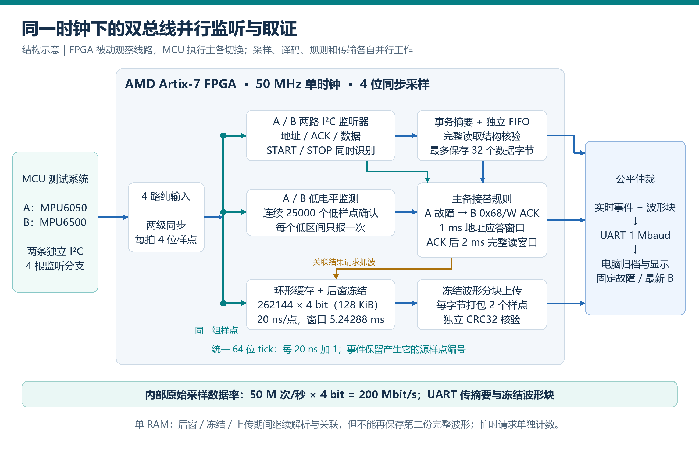

# I²C Sentinel · FPGA 双路 I²C 总线异常分析仪

四路50MSa/s同步采样，20ns统一时基，262144点环形缓存；双路协议解析、低电平监测、故障关联与BRAM并行工作。MCU执行主备读取，FPGA旁路监听，电脑显示、归档和重放。200Mbit/s为内部采样位流；UART为1Mbaud，上传事件与冻结波形。

**English introduction**

I²C Sentinel is an FPGA-based dual-bus I²C anomaly analyzer built on the AMD Artix-7 platform. It synchronously samples four channels at 50 MSa/s per channel, providing 20 ns time resolution. FPGA hardware parallelism enables simultaneous protocol decoding, anomaly detection, fault correlation, and waveform buffering across both buses. By passively monitoring bus activity, the system detects address NACKs and SCL-low timeouts and verifies MCU-controlled failover between primary and backup devices. A companion PC application provides waveform visualization, event logging, and offline replay to support bus fault diagnosis and communication reliability verification.

本包于2026年10月27日同步上位机最新故障自动跟随修复，新增4项回归；当前31项单元及配套检查见[更新与验证](docs/pc_update_20261027.md)。

## 阅读入口

- 设计报告：[PDF](report/design_report.pdf) · [Word](report/design_report.docx)
- [上板复现与下载](#上板复现与下载) · [从源码重新构建](#从源码重新构建)
- [实现说明](docs/design.md) · [04协议](docs/protocol_04.md)
- [数据与证据索引](report/evidence_index.md) · [仿真结果](sim/results/README.md)
- [AI协作精选](report/ai_collaboration.md) · [176条对话正文](report/ai_conversations.md) · [可复用Skill](skill/README.md)

## 系统架构

MCU负责访问A路MPU6050、B路MPU6500并执行主备切换；FPGA通过四根只输入的监听线观察两条I²C总线。电脑接收FPGA的事件与冻结波形，完成校验、显示、归档及离线回放。



FPGA内部使用同一个50MHz时钟。四路输入经过两级同步后，每20ns产生一组4位样点，同时送入以下并行通路：

- **双路协议解析：** A、B各有独立的I²C监听器，同时识别START、地址、ACK/NACK、数据和STOP，并生成事务摘要。
- **异常与关联判断：** 低电平检测与协议解析同时运行；关联规则以统一的源样点时间检查A故障后B地址应答是否在1ms内，以及应答后是否在2ms内完成规定的14字节读取。
- **原始波形缓存：** BRAM环形缓存持续记录同一组样点，容量为262144×4bit（128KiB），对应5.24288ms窗口；接受抓拍请求后收齐后窗，再冻结上传。

实时事件通过独立FIFO排队，与冻结波形块共同送入仲裁和1Mbaud UART。上传期间协议解析与规则判断仍运行；单块波形RAM在后窗、冻结和上传期间不能接纳第二份完整捕获，未保存的抓拍请求单独计数。200Mbit/s是FPGA内部采样位流，串口传输的是事件和冻结波形。模块连接与接口细节见[实现说明](docs/design.md)。

## 目录结构与赛题对照

本仓库按FPGA、MCU、电脑端及验证材料细分目录。以下目录树展示实际文件位置；后面的对照表说明它们与赛题推荐结构的对应关系。

```text
fpga_i2c_sentinel/
├── README.md                         # 项目简介、系统架构、目录对照和复现步骤
├── src/                              # 设计源码
│   ├── vivado_prj/
│   │   ├── rtl/                      # FPGA Verilog模块
│   │   ├── constr/                   # 板级引脚及时钟约束XDC
│   │   ├── sim/                      # 8组testbench
│   │   └── scripts/                  # Vivado建工程、构建和仿真脚本
│   ├── mcu/                          # Keil工程、MCU源文件与依赖头文件
│   └── pc/                           # 上位机、回归测试与锁定依赖
├── sim/
│   ├── run_sim.ps1                    # 统一仿真入口
│   └── results/                      # 结果汇总与8份最终通过日志
├── build/
│   ├── build_fpga.ps1                 # FPGA构建入口
│   ├── build_mcu.ps1                  # MCU构建入口
│   └── reports/                      # 资源、时序和DRC报告
├── board/
│   └── firmware/                     # 正式FPGA .bit和MCU .hex映像
├── data/                             # 100轮记录、性能、验证和版本对比4张CSV
├── skill/
│   ├── README.md                     # 两个Skill的说明与使用边界
│   ├── fpga-bus-analyzer-tutor/       # FPGA学习指导与配套参考
│   └── fpga-evidence-workflow/        # 工程证据与验证工作流
├── report/                           # 设计报告、实测配图及AI协作记录
├── docs/                             # 实现、串口协议和PC更新说明
├── tools/                            # 上位机启动与检查脚本
├── start_pc.bat                      # Windows双击启动入口
├── use_doc.txt                       # 安装、连接与操作说明
├── checksums.sha256                   # 提交文件校验清单
└── .gitignore                        # 排除构建缓存和本机运行产物
```

| 赛题推荐项 | 本仓库对应位置 | 内容说明 |
|---|---|---|
| `README.md`：项目简介与复现步骤 | [本页](README.md) | 中英简介、系统架构、目录对照、运行与重建步骤 |
| `src/`：设计源码 | [FPGA](src/vivado_prj/)、[MCU](src/mcu/)、[电脑端](src/pc/) | RTL、XDC、Keil工程及上位机源码 |
| `sim/`：仿真或验证脚本与结果 | [仿真入口](sim/)、[testbench](src/vivado_prj/sim/)、[结果日志](sim/results/README.md) | 激励保留在FPGA源码目录，根目录`sim/`提供统一运行入口和最终结果 |
| `build/`：可复现构建脚本与综合实现报告 | [构建入口及报告](build/) | FPGA/MCU构建入口，FPGA资源、时序与DRC报告 |
| `board/`：上板工程、运行脚本与实测输出 | [正式映像](board/firmware/)、[板级约束](src/vivado_prj/constr/)、[运行工具](tools/)、[实测统计](data/)、[配图](report/figures/) | 映像集中于`board/`；工程、约束、运行脚本和实测材料按用途分开保存 |
| `data/`：测试数据与参考结果 | [四张统计表](data/) | 100轮记录、性能统计、验证汇总和版本对比；原始采集数据另行归档 |
| `skill/`及`skill/README.md`：技能包 | [技能包说明](skill/README.md) | FPGA指导Skill与工程证据工作流，各附所需参考 |
| `report/`：设计报告与大模型协作记录 | [PDF报告](report/design_report.pdf)、[Word报告](report/design_report.docx)、[AI精选](report/ai_collaboration.md)、[对话正文](report/ai_conversations.md) | 报告、实测配图、三个纠错案例及176条可见对话正文 |

`docs/`与`tools/`是补充目录，分别保存接口说明和电脑端运行工具。硬件下载需按实际板卡、下载器和工具配置操作；本仓库的构建入口只编译，不自动下载硬件。

## 验证结果与材料范围

2026年10月21日：M1/M2/M3各20/40/40，100份完整捕获；B100轮及正常A20轮均与同轮MCU14字节一致。正常区间CRC、帧序、重组及七路FIFO丢失均0。完整波形接收平均1.660386s，为电脑批次计时，不是TX线端测时。

本精简版仅保留8份最终仿真自检日志，不附原始串口流、逐点样本、大量历史调试日志或工具缓存。完整证据在队伍本地归档保留；四张表和配图用于展示结果。源码可重建，仿真流运行时生成；完整历史实测数据不在仓库中，不能仅凭表格重新解码100轮原始波形。

## 上板复现与下载

建议首次先使用仓库中的正式映像，按“核对文件 → 接线 → 下载MCU → 配置FPGA → 打开上位机 → 切换模式验收”的顺序操作。需要修改设计时，再执行后面的[源码重建](#从源码重新构建)。下面的命令均在项目根目录运行，即同时包含`README.md`、`board/`、`src/`和`start_pc.bat`的目录。

### 1. 准备硬件和软件

| 类别 | 本工程使用的配置 | 用途 |
|---|---|---|
| FPGA板 | 野火升腾Pro，Artix-7 `XC7A100T-FGG484-2`，50MHz时钟 | 双路监听、采样、异常关联和波形缓存 |
| MCU板 | Keil工程目标为`STM32F103C8`，固件使用72MHz系统时钟 | 驱动传感器、制造演示故障并执行主备读取 |
| 传感器 | A路MPU6050、B路MPU6500，各用一条I²C总线 | 正常读取和主备切换演示 |
| 显示和按键 | 与现有`oled.c`驱动兼容的I²C OLED；PB12模式键 | 显示M0～M3和读取状态，切换测试模式 |
| 下载器 | FPGA板载JTAG接口或兼容下载器；MCU使用ST-Link | 两个芯片分别下载，不能互相代替 |
| 串口 | FPGA板载USB串口，或与板级TX引出方式相符的3.3V USB-TTL | 将FPGA串口数据送入电脑 |
| FPGA下载工具 | Vivado 2018.3，安装Artix-7支持及相应JTAG驱动 | 用Hardware Manager下载`.bit`；重建时也使用该版本 |
| MCU下载工具 | STM32CubeProgrammer及ST-Link驱动 | 将现成`.hex`写入MCU Flash并校验 |
| 上位机环境 | Windows、Python 3.10～3.12，推荐已验证的3.12，包含pip和Tkinter | 接收、显示和归档；首次启动需联网安装锁定依赖 |
| MCU源码重建工具 | Keil µVision，ARMCC 5.06 update 5 | 仅在重新编译MCU时需要，目标名`Failover400` |

下载或完整解压本仓库，建议使用纯英文路径，例如`C:\fpga\fpga_i2c_sentinel`。更换FPGA型号、板卡版本、MCU或晶振时，需要重新核对约束和时钟配置，不能直接沿用现成映像。

### 2. 选对下载文件

| 文件 | 用途 | 应交给哪个工具 |
|---|---|---|
| [task_last_1000000.bit](board/firmware/task_last_1000000.bit) | 正式FPGA配置，50MSa/s、262144点、1Mbaud UART | Vivado Hardware Manager，下载到FPGA |
| [mcu4_400.hex](board/firmware/mcu4_400.hex) | 四模式MCU程序 | STM32CubeProgrammer，经ST-Link写入MCU |
| [task_last.xdc](src/vivado_prj/constr/task_last.xdc) | 引脚、电平和时钟约束 | Vivado构建时读取，不单独下载 |
| `src/vivado_prj/rtl/*.v` | FPGA逻辑源码 | 先综合、实现并生成`.bit`，再下载 |

本步骤的MCU烧录文件仅指`board/firmware/mcu4_400.hex`；仿真运行产生的`core_stream.hex`等文件是串口测试数据，不能用来烧录MCU。

在项目根目录的PowerShell中核对两个映像的SHA256，与[文件校验清单](checksums.sha256)中相应文件的记录比较：

```powershell
Get-FileHash -LiteralPath .\board\firmware\task_last_1000000.bit -Algorithm SHA256
Get-FileHash -LiteralPath .\board\firmware\mcu4_400.hex -Algorithm SHA256
```

### 3. 断电接线并核对通道

四路监听线是从原有I²C线上分出的支路；FPGA只读取电平，MCU仍是总线控制器。按[当前XDC](src/vivado_prj/constr/task_last.xdc)核对引脚，不能照搬其他开发板的排针位置。

| 信号 | MCU/外设连接 | FPGA封装引脚 | 当前升腾Pro排针位置 |
|---|---|---|---|
| A_SCL | MCU PB10 ↔ MPU6050 SCL，并分支到FPGA | L13 | CN4-5 |
| A_SDA | MCU PB11 ↔ MPU6050 SDA，并分支到FPGA | M13 | CN4-6 |
| B_SCL | MCU PB13 ↔ MPU6500 SCL，并分支到FPGA | M16 | CN4-7 |
| B_SDA | MCU PB14 ↔ MPU6500 SDA，并分支到FPGA | M15 | CN4-8 |
| 公共地 | MCU、传感器、FPGA及外接USB-TTL共地 | 板卡GND | CN4-3可作公共地 |
| FPGA串口TX | 经板载串口通路，或接外部USB-TTL的RX | N17 | 依板卡串口电路/丝印确认实际引出位置 |

上述CN4位置对应本工程XDC注明的升腾Pro映射。先按实物版本和排针方向核对；**CN4-1/2为5V，不能当作3.3V或接到四路监听输入**。总线使用3.3V上拉和兼容3.3V逻辑，各板按自己的供电方式上电，电源输出之间不直接并联。

其余连接：

- MPU6050与MPU6500都配置为7位I²C地址`0x68`，AD0接地；MPU6500的NCS接3.3V以使用I²C。WHO_AM_I身份值分别是`0x68`和`0x70`，身份值与总线地址含义不同。
- OLED的SCL接MCU PB8，SDA接PB9；模式按键接PB12，程序使用内部下拉，按下时接3.3V。按键每次在M0→M1→M2→M3→M0间切换。
- FPGA的时钟W19和低有效复位N15为板级连接；使用板卡原有时钟和复位。当前版本自动监听，不需要按FPGA的KEY2布防。
- MCU另有PA9、115200/8N1结果串口，属于可选的独立核对口。FPGA上位机要连接的是**FPGA的1Mbaud串口**，不要选成MCU串口，也不要将两块芯片的TX并接到同一个RX。

### 4. 经ST-Link下载MCU程序

1. 如MCU中有需要保留的其他工程，先备份其固件。关闭占用ST-Link的Keil调试会话，按下表接好SWD，再给MCU正常供电。BOOT0保持正常从Flash启动的低电平状态。

   | ST-Link信号 | STM32F103连接 |
   |---|---|
   | SWDIO | PA13 |
   | SWCLK | PA14 |
   | GND | MCU GND |
   | VTref/目标电压参考 | 按下载器说明接目标3.3V参考；供电方式按下载器和MCU板说明确认 |
   | NRST（复位连接时使用） | MCU NRST |

2. 打开STM32CubeProgrammer，选择`ST-LINK`连接方式、`SWD`端口，选中实际下载器。初次可用1MHz的SWD频率，点击右上角`Connect`，确认读到了目标器件和供电电压。
3. 打开`Erasing & Programming`面板，用`Browse`选择本仓库的`board/firmware/mcu4_400.hex`。HEX自身携带地址，本固件写入从`0x08000000`开始的内部Flash；不要将它当作无地址的BIN文件重新指定到其他区域。
4. 勾选`Verify after programming`。目标Flash不是空白时保留正常的下载前擦除流程，不勾选`Skip flash memory erase before programming`；点击`Start Programming`。
5. 等待写入和读回校验完成且无错误，然后断开下载器的调试连接，复位MCU使其正常运行。OLED应显示`MCU4 M:0`或等价的M0空闲状态；此时先不切换模式。

这里是下载已经生成的HEX。若先从源码重建，使用后文生成的`src/mcu/objects/mcu4_400.hex`，下载流程相同。界面位置因CubeProgrammer版本略有差别，操作名称可对照[ST官方入门](https://dev.st.com/stm32cube-docs/stm32cube-getting-started/1.1.1/en/markup/Ecosystem_Code_Programming/Ecosystem_Code_Programming.html)及[下载与校验说明](https://dev.st.com/stm32cube-docs/prog/2.23.0/en/docs/markup/CubeProg_UserManual/Memory_programming_and_erasing.html)。

### 5. 用Vivado将BIT配置到FPGA

1. 给FPGA板正常供电，通过板卡JTAG接口或兼容下载器连接电脑。下载线应接JTAG功能接口；USB串口只用于上位机接收，不能替代JTAG下载连接。
2. 启动Vivado 2018.3，进入`Open Hardware Manager`。使用现成BIT时无需先创建一个空工程，也无需单独打开XDC。
3. 在Hardware Manager中选择`Open Target → Auto Connect`，连接本机硬件服务器和下载器。确认硬件列表出现`xc7a100t`器件，例如`xc7a100t_0`，并与实物板卡一致。
4. 右键该FPGA，选择`Program Device`，在`Bitstream file`或`Programming file`中选择本仓库的`board/firmware/task_last_1000000.bit`。本映像用UART观察结果，不依赖ILA的`.ltx`探针文件。
5. 点击`Program`，等待进度完成且无错误。检查器件属性中的DONE状态；如板卡提供DONE灯，也可辅助观察。配置完成仅说明BIT已装入FPGA，功能还需按后面的模式验收。
6. 保持FPGA供电。当前设计会自动采样、解析并等待总线事务，无需给FPGA发送串口命令或按键布防。

这是**JTAG配置FPGA**：`.bit`装入的是易失配置，断电后本次配置丢失；再次上电可能运行板载Flash中原有的其他设计，要复现本工程需重新执行本节。MCU的HEX写入内部Flash，正常断电后仍保留。若需要FPGA断电自启，应按实际板载配置Flash型号另做固化；仓库未提供针对该Flash的已验证MCS/BIN或一键固化流程，不能把本节操作当作已固化。Vivado界面和DONE检查依据[AMD UG908（2018.3），第4章](https://docs.amd.com/v/u/2018.3-English/ug908-vivado-programming-debugging)。

### 6. 启动上位机并连接FPGA串口

1. 完整解压或克隆项目，在根目录双击[start_pc.bat](start_pc.bat)。首次自动建立本包`.venv`并安装锁定依赖；以后直接启动。仅运行上位机不需要Keil。
2. 在Windows设备管理器确认FPGA对应的串口号，再在界面选择该`COM`口；不要固定照抄他人的COM号。
3. 波特率选`1000000`，链路为8数据位、无校验、1停止位（8N1），点击“连接监测”。关闭其他占用同一端口的串口助手。
4. 保持电脑接收，随后用MCU的PB12模式键发起测试。M0没有主动读取，尚无新波形不等于下载失败。
5. 接收完整捕获后检查波形、译码和异常结果。界面默认跟随最新完整故障；双击捕获列表会手动固定，点击“跟随最新故障”恢复。捕获会归档到`src/pc/captures/`，可用界面的“打开归档波形”离线重放。操作细节见[use_doc.txt](use_doc.txt)。

### 7. 按M0～M3逐项验收

MCU上电为M0，每按一次PB12进入下一模式。M1～M3每轮约5秒，给FPGA足够时间上传完整波形；每种模式建议观察至少3轮。切换后的首次传感器初始化可能较长，重点核对初始化结束后的稳定轮次。

| 模式 | MCU行为 | FPGA/电脑端应核对的现象 |
|---|---|---|
| M0 | 释放两路总线，不主动读取 | 不主动产生新事务；已经归档的历史记录仍保留 |
| M1 | 依次读取A、B，各14字节 | 正常B完整读取和正常捕获；检查真实译码数据，不能用界面占位值代替采样结果 |
| M2 | 访问A的`0x6A`，得到地址NACK后转B | A地址NACK、B的`0x68/W`地址ACK关联，以及后续完整14字节读取；故障与备用读取结果分别显示 |
| M3 | A的SCL拉低，约500µs确认故障后读B，低至少1ms再释放A | A持续低事件、B地址ACK和完整读取；A仍低时B可独立通信 |

B地址应答的规则为A故障到B的`0x68/W ACK`间隔不超过1ms；完整读还需满足从该ACK到规定读取STOP不超过2ms，以及`0x3B`起始寄存器、14字节和正确的结束应答结构。**地址ACK及时不等于完整读取成功。**检查CRC、帧序、捕获完整性及FIFO丢失/忙时未保存计数，记录实际值；单块RAM上传忙时的新抓拍可能无法保存，事件解析仍运行。

验收完成后再按一次回M0。仓库的历史100轮数据属于既有验证记录，本节是读者重新复现的操作步骤，不表示新接线和新构建已经完成同样验收。复现时可保存每轮捕获文件、模式、CRC/序号统计和截图，形成自己的记录。

### 8. 常见问题排查

| 现象 | 先检查 |
|---|---|
| Vivado找不到器件 | 板卡电源、JTAG功能接口/线缆及驱动、下载器是否被其他Vivado会话占用；USB串口被识别不代表JTAG已连通 |
| 提示BIT与器件不匹配 | 确认板卡为XC7A100T-FGG484-2，并选择本仓库正式BIT；换板后应重新核对XDC并构建 |
| ST-Link连接失败 | MCU供电和共地、SWDIO=PA13/SWCLK=PA14，不能接成I²C的PB13/PB14；关闭其他调试连接，降低SWD频率，必要时接NRST使用复位连接 |
| 下载成功但上位机没有波形 | MCU是否仍在M0、是否已正常运行而非暂停在调试器、是否选对FPGA串口、FPGA复位是否释放以及四路监听是否接通 |
| CRC错误、丢字节或捕获不完整 | BIT和电脑端都应为1000000baud，检查串口占用、线缆和共地；MCU PA9的115200结果口不是FPGA数据口 |
| B没有完整读取或设备身份错误 | B供电/地、NCS高和AD0低、PB13/PB14接线与3.3V上拉；核对WHO_AM_I，不把`0x70`当成B的I²C地址 |
| 启动报缺文件或缺Python | 完整解压整个项目，保留`tools/`与`src/`；安装Python 3.10～3.12并确认首次安装依赖的网络可用 |
| 断电后FPGA不再工作 | JTAG下载的BIT会丢失，重新配置；这与MCU Flash保留程序是两种机制 |

## 从源码重新构建

只有需要检查源码、重新生成映像或修改配置时，才执行本节。构建入口只做离线编译、仿真和报告生成；生成后仍需按上节分别下载MCU和FPGA。

### 1. 建立Python环境并检查PC

在项目根目录打开PowerShell，先确认`python --version`为3.10～3.12，然后执行：

```powershell
python -m venv .venv
./.venv/Scripts/python.exe -m pip install -r ./src/pc/requirements-lock.txt
./tools/check_pc.ps1 -PythonExe "$PWD/.venv/Scripts/python.exe" -UnitOnly
```

如果已用`start_pc.bat`建好本包环境，可直接使用该`.venv`。`-UnitOnly`不要求先生成RTL串流；GUI及串流回放检查放在下一步。若PowerShell提示禁止运行脚本，可先在当前窗口执行`Set-ExecutionPolicy -Scope Process -ExecutionPolicy Bypass`，该设置仅作用于当前会话，再重试命令。

### 2. RTL仿真与完整PC离线检查

把`VivadoBin`换成本机Vivado 2018.3的`bin`目录：

```powershell
./sim/run_sim.ps1 -VivadoBin 'C:/Xilinx/Vivado/2018.3/bin'
./tools/check_pc.ps1 -PythonExe "$PWD/.venv/Scripts/python.exe"
```

仿真应逐项出现8个对应的`PASS ALL`标记；新日志和测试串流生成在`src/vivado_prj/verification/sim/`。PC完整检查包含单元、串流回放和GUI/布局/归档检查，部分检查会创建测试窗口。保留本机日志，既有最终通过记录见[仿真结果](sim/results/README.md)。

### 3. 构建FPGA并找到新BIT

```powershell
./build/build_fpga.ps1 -VivadoBin 'C:/Xilinx/Vivado/2018.3/bin' -Baud 1000000
```

脚本读取`src/vivado_prj/rtl/`及`constr/task_last.xdc`，以`task_last_top`为顶层、`xc7a100tfgg484-2`为目标，完成综合、布局布线、时序与DRC检查后生成：

```text
src/vivado_prj/project/task_last.xpr
src/vivado_prj/verification/build_inputs.json
src/vivado_prj/verification/build_1000000/task_last_1000000.bit
src/vivado_prj/verification/build_1000000/timing.rpt
src/vivado_prj/verification/build_1000000/utilization.rpt
src/vivado_prj/verification/build_1000000/drc.rpt
```

构建通过会输出`PASS OFFLINE BUILD`；具体资源和时序以这次生成的报告为准。随后在Vivado Hardware Manager中选择**新生成路径下的BIT**执行下载。仓库的`board/firmware/`映像不会被构建脚本自动覆盖，避免把历史文件误当成本次产物。

### 4. 构建MCU并找到新HEX

安装Keil ARMCC 5.06 update 5，提供本机工具路径：

```powershell
./build/build_mcu.ps1 -Uv4Path 'C:/Keil_v5/UV4/UV4.exe' -FromElfPath 'C:/Keil_v5/ARM/ARMCC/bin/fromelf.exe' -PythonExe "$PWD/.venv/Scripts/python.exe"
```

工程入口为[project.uvprojx](src/mcu/project.uvprojx)，目标`Failover400`，设备`STM32F103C8`。脚本要求编译`0 Error(s), 0 Warning(s)`，并检查关键计时循环的反汇编；产物为：

```text
src/mcu/objects/mcu4_400.hex
src/mcu/objects/mcu4_400.axf
src/mcu/verification/keil_build.log
src/mcu/verification/disassembly.txt
```

也可在Keil中打开该工程、选中`Failover400`后Rebuild；应沿用ARMCC5和工程已有配置。再将新HEX通过STM32CubeProgrammer下载并校验，之后重复M0～M3验收。改过主频、编译器、GPIO或计时逻辑时，旧时序结果不能代替本次验证。

生成的`project/`、`verification/`、`objects/`、`listings/`及Python缓存按`.gitignore`排除。源码和接口细节见[实现说明](docs/design.md)与[04协议](docs/protocol_04.md)，历史构建和PC验证范围见[PC更新记录](docs/pc_update_20261027.md)。本节步骤于2026年11月3日按仓库脚本与官方工具文档补充，属于复现操作说明，本次文档整理未重新执行烧写、上板或完整构建。

自研部分发布协议与作者信息由权利人填写；项目仓库：[GitHub](https://github.com/bbdd777/FPGA-Based-Dual-Bus-I-C-Anomaly-Analyzer)。
