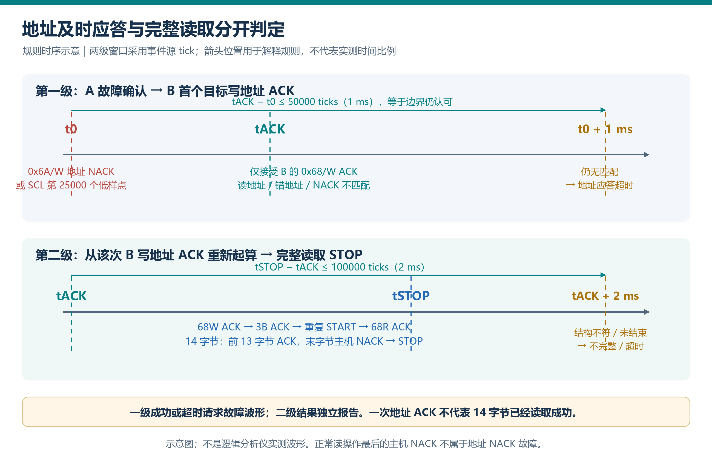
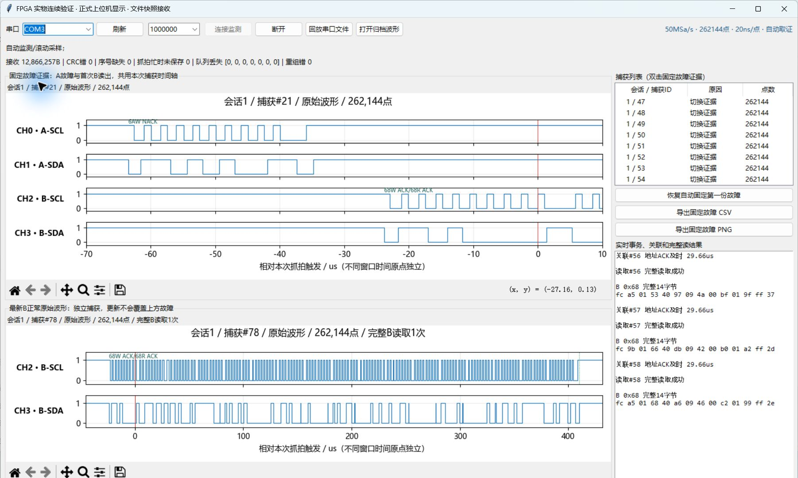
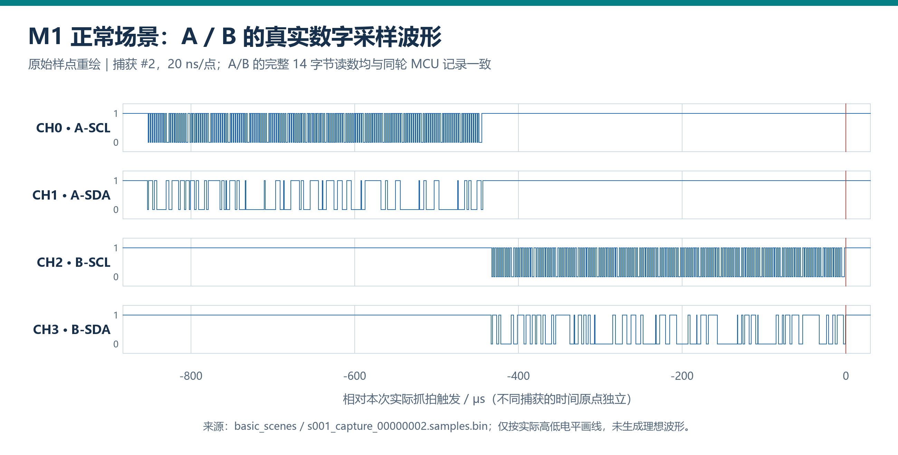
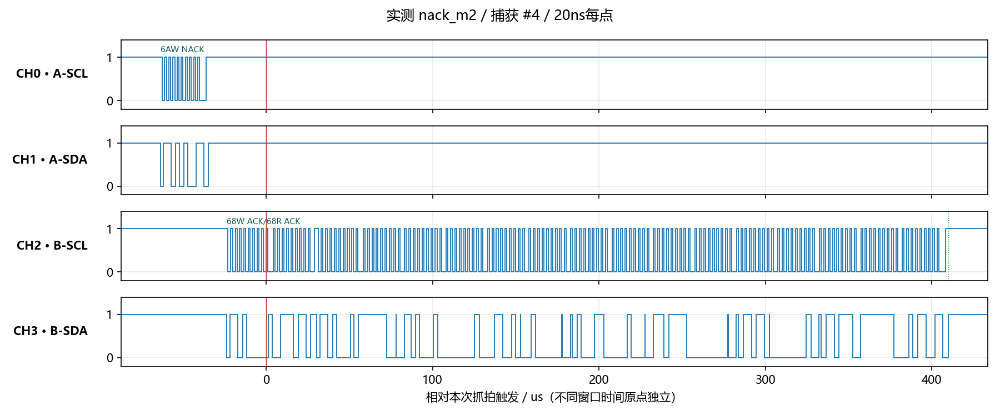
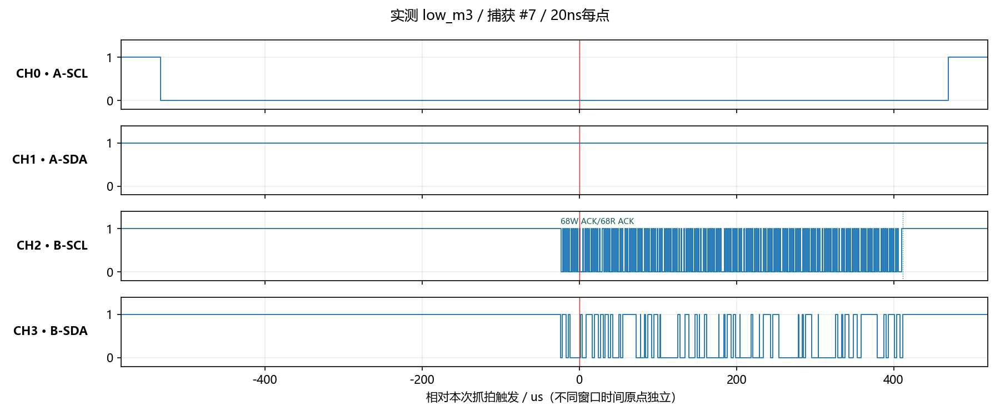
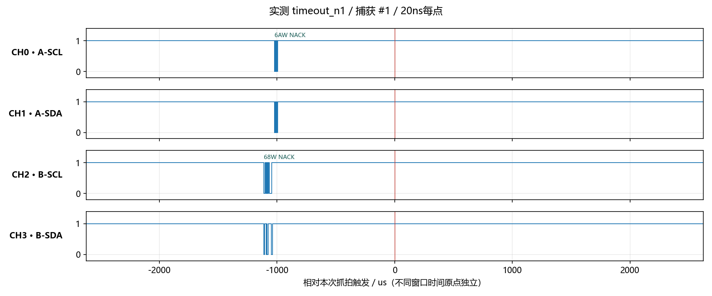
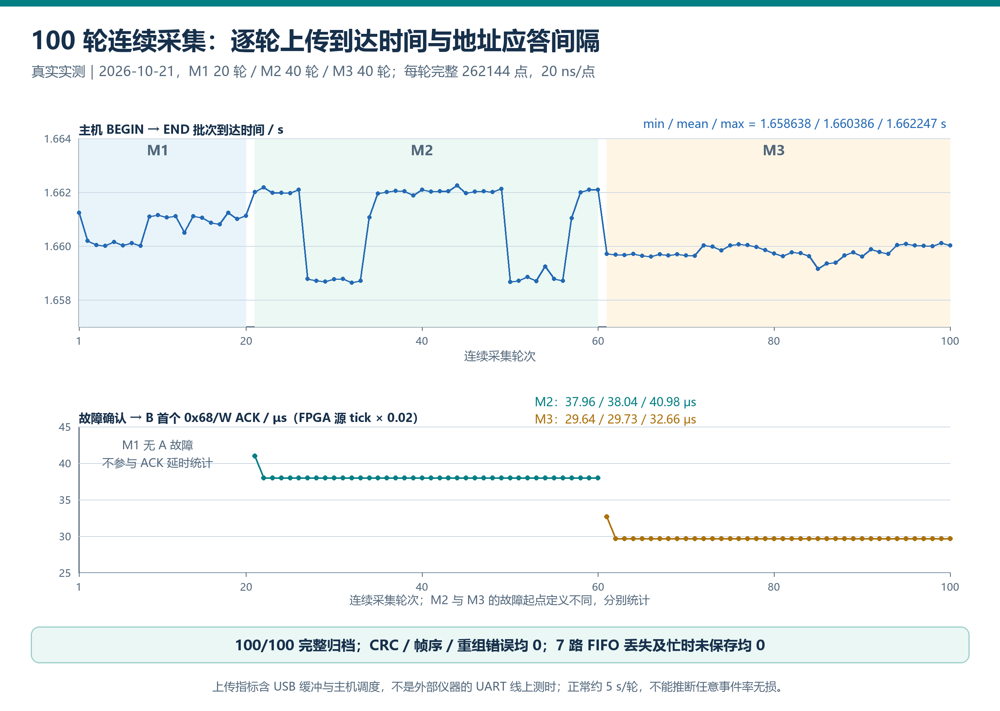
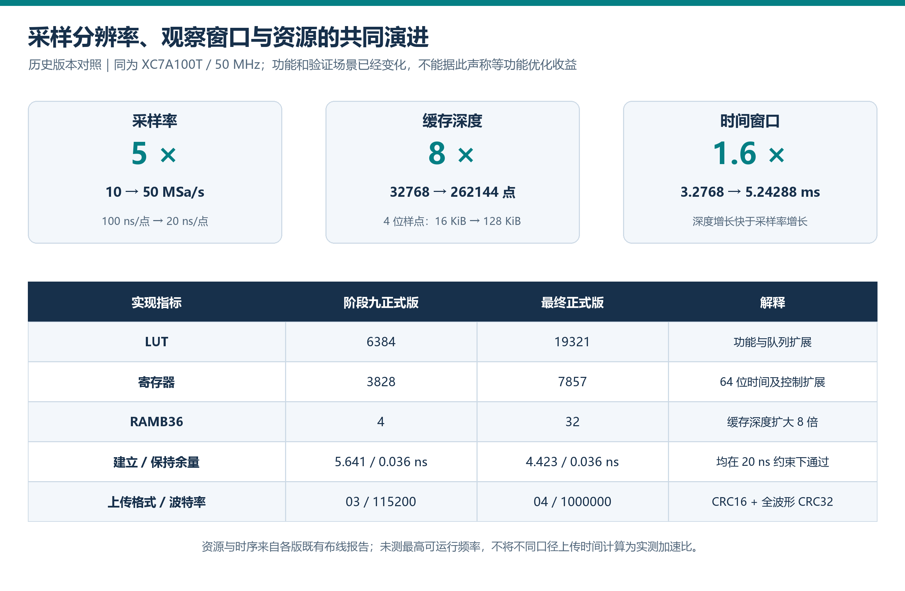

# 基于 FPGA 的双路 I2C 总线异常分析仪

AMD 自主选题赛道完整设计报告  
文档日期：2026年10月23日；提交目录精简于2026年10月26日

本精简仓库提供四张统计表、关键实测图、必要源码和构建报告；完整原始采集及调试记录由队伍另行归档。

## 摘要

本作品面向双传感器系统的通信调试与备用链路验证，解决单条软件日志难以同时说明“主路何时异常、备用路是否应答、数据是否完整读出”的问题。系统采用 AMD Artix-7 XC7A100T，以单一50MHz时钟对两条I2C总线的四根信号线进行并行采样，每通道50MSa/s，所有样点和事件共享20ns时基。FPGA内部同时运行双路协议解析、持续低电平监视、事务摘要、跨总线关联规则和BRAM写入；MCU负责真实传感器业务及故障注入，电脑负责校验、显示、归档和回放。

分析仪先确认A路指定地址NACK或SCL持续低，再分别核验B路是否在1ms内完成目标写地址ACK，以及随后是否在2ms内完成规定的14字节读取。262144点环形缓存保存5.24288ms四通道波形；单块RAM冻结上传时，协议解析与事件生成继续运行，由有界FIFO排队。采用1M baud UART、04版分块协议和两级CRC校验，将固定故障证据与最新有效B波形分别保留。

2026年10月21日独立重测取得100份完整波形，包含M1正常20轮、M2地址NACK40轮、M3持续低40轮。100轮B数据及20轮M1的A数据均与同轮MCU参考逐字节一致；该测试区间CRC、帧序、重组、七路FIFO丢失及忙时未保存计数均为零。完整波形主机接收批次耗时平均1.660386s。实现占19321个LUT、7857个寄存器和32个RAMB36，50MHz约束下建立余量4.423ns。报告同时给出版本演进、真实模型协作纠错、可复用Skill和复现步骤，并明确单缓存波形空窗、队列容量及测量口径。

关键词：FPGA；双路I2C；统一时基；故障关联；环形缓存；可追溯验证

## 1 选题背景与应用价值

### 1.1 从应答判断走向故障取证

在传感器采集原型中，程序可以通过返回值发现通信失败，却不一定保留失败附近的线路细节。若A路异常后立即访问B路，仅有“切换成功”提示还不能回答三个问题：故障从哪个线路事件开始计时，B的目标地址是否真正应答，后续寄存器数据是否完整。将MCU软件日志与电脑接收时刻直接相减，也会混入执行、缓存和串口传输延迟。

本作品把实际总线作为观察对象，从同一组原始样点生成事件和波形，以明确的规则连接A故障与B读取。它适用于实验室传感器接口排查、双设备备用策略验证和FPGA协议监测教学。现成开发板与传感器模块组成原型，作品的工程成果集中在RTL、MCU激励、传输协议、上位机及验证数据，没有独立定制机械结构。

### 1.2 设计目标与已有方法的关系

I2C规范已经定义START、STOP、地址、ACK和NACK等基本含义；协议译码本身属于已有方法。[NXP官方规范](https://www.nxp.com/docs/en/user-guide/UM10204.pdf)还说明接收端在第9个时钟应答，主机结束读取时可以使用NACK。因此，本作品将创新与应用价值落在跨总线的分级核验和证据管理，而不把普通译码描述为独创。

| 实际问题 | 作品提供的对应能力 | 可核查输出 |
|---|---|---|
| 两条总线的时间难对齐 | 四路同时取样、共用64位源tick | 原始四通道样点及事件时间 |
| 地址ACK被误作数据有效 | 1ms地址应答与2ms完整读分别判定 | 两类独立结果帧 |
| 刷新后故障现场被覆盖 | 固定故障和最新B分别引用已归档捕获 | 捕获编号、元数据和SHA256 |
| 只有最终截图难复核 | 保存原始流、样点和同轮MCU参考 | 逐轮表与离线回放审计 |

作品没有进行与商业逻辑分析仪或其他处理器方案的等条件对照，不据此声称全面性能领先。选择FPGA的理由是将本项目需要的并行数据通路直接实现为硬件，并让所有判断受同一时钟约束；其他架构能否达到同样目标需要另行实验。

## 2 平台、版本与设计指标

### 2.1 实际平台

FPGA使用升腾Pro Artix-7开发板，工程器件为`xc7a100tfgg484-2`。被测端为STM32F103C8、A路MPU6050和B路MPU6500，两条总线相互独立，正常7位地址均为0x68。A、B的身份寄存器分别实读0x68和0x70；身份值与总线地址含义不同。两路软件I2C保留既有MCU引脚，模式按键及OLED用于选择和观察激励状态。

| 项目 | 正式配置或已核查结果 | 依据 |
|---|---|---|
| FPGA系统时钟 | 50MHz，单一时钟域 | E01、E05 |
| 数字输入 | A-SCL、A-SDA、B-SCL、B-SDA，共4路 | E01、E02 |
| 采样 | 每拍一组4位样点；每通道50MSa/s，20ns/点 | E01 |
| 原始缓存 | 262144点，4bit/点，逻辑容量128KiB | E01、E05 |
| 完整时间窗 | 5.24288ms；触发索引131072 | E01、E04 |
| 规则阈值 | 低确认25000样点；关联50000间隔；完整读100000间隔 | E01、E02 |
| FPGA UART | 1,000,000 baud，8N1，04协议，只发送 | E02 |
| 实际工具 | Vivado2018.3；MCU使用Keil ARMCC5.06 update5 | E05、E09 |

Vivado2018.3是形成现有映像和实现报告的实际版本。AMD指南允许使用其他工具版本，但要求说明并保证脚本可复现；本报告据实声明版本，不把现有结果称为2025.2或2026.1验证结果。环境、源文件校验和及复现执行结果由E10登记。

### 2.2 证据版本分层

正式FPGA映像SHA256为`ef8cad742ec7c726048eac5982d16090dda800126693f2e9465dc90c64860ec2`。2026年10月21日的100轮属于该硬件配置和当时软件链路。截至10月22日，电脑端已陆续增加原因显示、导航、译码原始量和接收时钟；最新电脑端通过27项单元测试及GUI、历史流离线回归，不能将这一结果改写为“最新PC版本重新完成实体100轮”。历史阶段九报告只用于演进和协作案例，最终功能以E01至E07为准。

## 3 系统架构与软硬件划分


图1为依据最终源码绘制的结构示意。MCU及两块传感器构成被测系统；FPGA四个监听口均为输入，不产生SCL、SDA或ACK，也不执行主备切换；电脑处理经过校验的数据与显示交互。

### 3.1 FPGA承担的并行工作

四根异步输入先经过两级寄存器同步，再形成同一拍的四位样点。相同样点同时送往环形RAM、A/B两个协议解析器和A/B两个低电平监视器。每条总线保留自己的解析状态、位计数、地址方向、数据和摘要。A路等待第9位时，B路仍可识别自身边沿；规则模块和RAM写入也不需要等某一条协议处理结束。

这里的“并行”体现为多个时序模块在同一个50MHz上升沿更新。它不是对四根线逐次轮询，也不是由上位机收到字节后再决定源事件先后。内部每秒形成5000万组4位样点，对应200Mbit/s原始采样位流；这表示输入到片上数据通路的逻辑速率，不能当作UART上传带宽或被测I2C速率。

以400kHz目标SCL为例，一个周期为2.5µs，50MSa/s对应约125个采样点；旧10MSa/s配置约为25点。采样时间步长由100ns细化为20ns，有利于分辨地址第9位、短间隔和跨总线先后关系。这是由配置计算的分辨率，输入同步及规则流水延迟仍按各自接口定义。

### 3.2 任务分工依据

| 层次 | 主要任务 | 分工原因 |
|---|---|---|
| FPGA实时通路 | 同步、采样、双路译码、持续低确认、源tick关联、缓存 | 同时观察多路状态并固定判断粒度 |
| MCU被测端 | 初始化、14字节业务读取、NACK/拉低激励、备用读取 | 提供真实器件应答和可重复场景 |
| FPGA上传通路 | 有界事件排队、帧仲裁、RAM读取、CRC和UART | 将高速局部取证与低速传输分开 |
| 电脑端 | 帧解析、完整性校验、原始归档、显示、回放和导出 | 利用主机处理文件和交互，避免实时规则依赖UI |

`task_last_top.v`负责板级连接和复位同步释放，`analyzer_core.v`连接功能模块。上电自动监测，不依赖电脑下发布防命令。采样、解析和规则只依赖FPGA时钟，UI刷新或CSV导出不会改变源tick。这样安排也使原始波形、事件结果与主机显示可以分别验证。

## 4 同一时基采样与异常关联

### 4.1 样点和事件的时间定义

全工程64位`sample_tick`每20ns加一。解析器在完整第9位后发布一拍`valid`，并携带造成该事件的源tick。地址字段可能在下一事件前保持，因此消费端必须同时判断`valid`，不能把旧地址反复当成新应答。未观察到START的片段不猜测地址；正常读结束时的主机NACK与地址NACK分别处理。

输入同步会引入延迟，且数字取样存在20ns网格。各通道采用一致的同步与取样结构，关联比较在该数字观察时基内成立；20ns是配置的采样周期，绝对时基没有用外部仪器校准。事件公布拍、UART帧到达顺序和电脑墙上时钟均不等于源事件发生时刻。

### 4.2 两级关联规则



图2为规则时序示意，阈值属于本作品的应用策略。规则先锁存A首次故障，再依次回答“B是否及时应答”和“B是否完整读完”。

| 阶段 | 接受条件 | 结果及边界 |
|---|---|---|
| A故障起点 | A的0x6A写地址NACK，或A-SCL第25000个连续低样点 | 锁存首次源tick，重复故障不重启窗口 |
| B地址应答 | B的0x68写地址ACK，间隔≤50000 ticks | 等于1ms认可；下一间隔仍未匹配则超时 |
| B完整读取 | 从首个68/W ACK开始，规定事务结构满足且STOP间隔≤100000 ticks | 成功、不完整、超时分别记录 |

完整读取要求：68/W ACK、寄存器指针3B ACK、重复START、68/R ACK、14个数据字节、前13字节ACK、最后字节主机NACK、STOP。B读地址ACK、其他地址ACK或地址NACK不能替代首个目标写地址ACK。只看到最后NACK也不能认定完整读成功。

持续低按低样点数量确认：首个低样点记为K，第25000个记为K+24999。名义阈值为500µs；从首个低样点编号到确认编号的差为499.98µs，二者是“样点数量”和“样点间隔”的不同口径。40轮M3原始数据均核对到24999的编号差。同一连续低区间只报一次，恢复高电平后才重新计数。

### 4.3 截止点和取证点

规则以事件源tick比较，在处理同一批样点的事件后判断超时，避免边界ACK因寄存器传递而被抢先判超时。完整读STOP也按源编号处理边界。对应精确截止、同拍匹配、重复A、复位和64位编号场景由确定性仿真验证，见E06。

关联成功或超时提出故障波形请求，原因分别为5或4；没有进行中关联时，正常B完整读STOP可请求原因6波形。故障请求优先，首次接受的原因保持。A故障只启动等待，随后结果才请求捕获，这样故障前史和B行为能进入同一窗口。

`trigger_tick`是RAM控制器实际接受请求并写入的样点，不冒充源事件tick。经事件寄存器传递，典型捕获点比源边界晚2个样点。波形索引满足`first_sample_tick + trigger_index = trigger_tick`；事件标记用自身源tick换算。二者分别保存，才能解释波形和规则之间的固定处理延迟。

## 5 原始缓存、事件队列与传输协议

### 5.1 BRAM环形缓存

滚动阶段每拍写入一组4位样点，18位地址自然绕回。完整窗口严格包含触发前131072点，以及触发点和之后共131072点；触发沿写入点属于后半段，再写131071点后冻结。总逻辑容量为262144×4bit，即1048576bit、128KiB；时间窗为262144×20ns，即5.24288ms。

读出按首地址加时间偏移访问，不能把物理地址误当成触发索引。同步BRAM读有返回延迟，上传状态机等待`read_valid`后使用数据。地址和读使能采用同步控制，数组不逐点复位，复位清有效历史计数。若历史不足，按实际点数输出短窗，并设置标志，不伪造前史。存储结构及控制实现与[AMD UG473存储资源指南](https://docs.amd.com/v/u/en-US/ug473_7Series_Memory_Resources)所述同步块RAM使用方式相配合；实际资源以E05实现报告为准。

### 5.2 上传期间保留事件可见性

波形只有一块RAM，后采样、冻结及上传期间不能再保存另一份完整原始波形。期间A/B解析、低确认、关联和完整读判断仍运行，事件分别进入七个深32条FIFO：A摘要、B摘要、A故障、B故障、关联结果、完整读结果、状态配置。FIFO满时丢新条目并累计计数；满且同拍出队可接纳新条目。

仲裁在完整帧之间切换，事件与波形均获得发送机会；连续事件最多发送两帧后让一块波形前进。状态单独上报七路丢失、峰值以及RAM忙时未保存数。队列丢失与波形未保存是两种情况，不能合成“系统无损”一句话。正常约5秒一轮的100轮计数为零，只支持该测试负载下的结论。

### 5.3 04协议与打包效率

| 内容 | 设计约定 |
|---|---|
| 公共头 | AA55、版本04、类型、32位帧序、64位源tick、capture_id、长度 |
| 帧级校验 | CRC16-CCITT-FALSE，覆盖版本到负载末尾 |
| 波形帧 | 开始40、数据块41、结束42；完整波形1024块 |
| 样点打包 | 一字节容纳两个4位样点，低半字节先；奇数末点高半字节为零 |
| 完整波形校验 | CRC32按时间顺序解包后的样点字节计算 |
| 一致性检查 | 块偏移连续、无重复/越界、点数一致、CRC32正确后才公布 |

262144点打包成131072字节；包含开始、分块开销和结束帧，不含实时记录时共163952字节。1M baud、8N1每字节占10位，对应纯线上理论时间1.63952s；它是协议计算值。实测主机批次差约1.660s，包含USB缓冲与调度，不能称为独立仪器测得的TX线时间。

200Mbit/s内部原始位流与UART的1Mbit/s线速相差200倍；8N1有效字节能力还需扣除起止位及协议开销。半字节打包减少了冗余，却不能让UART连续传送全速四通道原始数据。系统因此采用片上窗口取证加持续事件摘要，而不声称全程原始波形无空窗。字段、CRC测试向量、会话复位和错误拒收规则见[E02协议说明](../docs/protocol_04.md)。

## 6 上位机显示与可追溯数据管理

上位机将串口接收、协议解析和归档放在后台线程，UI每100ms读取合并快照。合并的是显示状态，原始串口字节和事件日志仍保留。接收字节队列有容量上限，满时中止并报告，不在漏数据后继续声称完整。新配置建立新会话，捕获编号与会话号组合，防止FPGA重新配置后的编号覆盖旧文件。

截至10月27日，故障区默认跟随`latest_fault`显示最新完整故障；双击历史或打开归档后手动固定，点击“跟随最新故障”恢复。`pinned`仍保留首份故障供历史接口使用，`latest_b`只更新为包含真实完整B读取的捕获。仅B刷新不重建上方故障坐标轴，用户可缩放查看原故障。新关联结果通过`correlation_id`与波形开始帧关联；没有对应开始帧时，只显示事件结论，不能为忙时结果生成一份不存在的波形。

每份完整捕获保存样点BIN、元数据JSON及SHA256，CSV和图像导出不作为原始数据落盘的前提。绘图从完整样点提取所有实际边沿，保留单样点脉冲，避免简单隔点抽取掩盖短事件。A/B译码面板给出加速度、温度、角速度的有符号16位原始量；未统一核查量程和器件换算前，不套用同一物理量公式。

最新PC顶部另显示电脑收到异常记录的年月日、毫秒和时区。该时间在串口驱动交付批次、入解析队列前记录，分片帧以收齐的批次为准；后续B结果不刷新首次异常时间。回放明确标注来源，旧档没有时钟就不补造。这个时间帮助查找记录，源事件间隔仍由FPGA tick计算。最新PC验证见E07；实物双窗口与导出验证见E03，二者版本分别登记。



图3是2026年10月21日实物测试保存的历史界面，固定故障为捕获#21，最新B为#78，用于展示两份证据分别保留的使用方式；它不是第100轮截图，也不是10月22日新增接收时钟后的界面。

## 7 验证方法与实测结果

### 7.1 逐层建立验证链

验证采用“确定输入检查RTL边界—综合实现—真实器件场景—同轮参考比对—原始流回放”的顺序。8个RTL自检覆盖正式深度地址绕回、逐点读回、1ms等边界与超界、低确认N-1/N、队列满及同拍出入、奇数窗、UART停顿、忙时持续事件和错误读取拒绝。

正式262144点整链仿真为缩短运行时间将UART参数加速，采样率和深度保持正式值；实际1M波特率另由UART及串流激励逐位解码检查。仿真时间不作为实物上传耗时。既有整链输出494768字节，重组3份正式深度波形，帧CRC、帧序缺失和重组错误为零，详见E06。

### 7.2 三类真实场景及反例

| 场景 | 实际激励 | 核对重点 | 证据 |
|---|---|---|---|
| M1正常 | A/B依次完整读取14字节 | 两路内容、正常B原因6捕获 | E03、E04 |
| M2地址NACK | A故意访问0x6A，再读B | A第9位NACK、B首写ACK与完整STOP | E03、E04 |
| M3持续低 | A-SCL持续拉低，确认后读B | 低确认起点、A低期间B独立读取 | E03、E04 |
| B地址缺失 | B AD0置高，0x68不再应答 | 关联超时，不误报本轮完整B成功 | E03 |



图4依据实收原始样点绘制。M1中A/B是依次读取，用来核对两个解析通路及同轮参考，不把这一场景说成两路真实重叠。



图5将A受控地址NACK、B目标应答和完整读结束放在同一源时间轴。M2故障确认到B首写ACK平均38.041µs；首ACK至完整STOP平均409.8475µs，两段分别计时。



图6体现A-SCL被保持低电平时，B解析与记录仍独立进行。M3低确认到B首写ACK平均29.7335µs；首ACK至STOP平均409.809µs。A原始连续低区间平均1000.456µs，不能把“低确认至ACK”解释为从首个低样点开始的全部耗时。



3轮地址缺失反例均在1000.02µs发布超时，符合等于1ms仍可接受、下一20ns间隔才超时的规则；无本轮完整B成功。恢复AD0低后，M2三轮和M1三轮恢复。该反例表明结果来自目标地址与真实应答条件，而非只按预设延迟生成成功提示。

### 7.3 独立100轮重测



| 指标 | 结果 | 统计口径 |
|---|---|---|
| 完整捕获 | 100份，每份262144点 | M1 20、M2 40、M3 40 |
| B数据对照 | 100轮均逐字节一致 | 同轮MCU的14字节参考 |
| A数据对照 | M1全部20轮一致 | M2/M3的A为受控故障 |
| 正常区间错误 | CRC/帧序/重组均0 | 独立重测原始流 |
| 队列与抓拍计数 | 七路FIFO丢失及忙时未保存均0 | 约5秒一轮的规定场景 |
| 主机接收耗时 | 最小1.658638、平均1.660386、最大1.662247s | BEGIN/END所在接收批次差 |
| 原始流审计 | 数量、点数、样点SHA256全部匹配 | 重新解析原始流对照实收归档 |

参考比对不是以FPGA摘要自证正确：逐轮记录MCU模式和轮号，从保存的SCL/SDA样点独立解码14字节，再比对同轮MCU数据。E04逐轮表保留模式、轮号、捕获编号、样点摘要及结论；原始串口、样点和MCU参考记录在完整归档中对应保存。

固件目标为400kHz，地址字节内数字采样观测A平均约401.063kHz、B约378.369kHz。报告使用观测值，不把配置目标当作两路精确实测值，也没有据此认证全部I2C电气时序。

### 7.4 失败保留与恢复边界

首次100轮尝试在第8份上传时因辅助快照文件替换遭遇WinError 5退出，前7份和未完成流单独保留，没有拼入通过的100轮。辅助取证脚本改为冲突计数后重试，使快照发布不再中断原始归档；独立重测期间1次冲突未造成波形或字节丢失。修复范围是辅助脚本，正式生产映像未改变。

串口句柄重连、上传中断后重连、同一bit的JTAG重新配置及上传中重配置均有恢复证据；有意中断产生的拒收不混入正常零错误统计。3次实际断电重启由操作者确认，但每次仍含重新配置和MCU核对/复位步骤，不能称为无调试器的无人干预启动试验。最初完整接线下的B初始化失败也保留，因启动映像及电气状态未独立核实，不指定唯一根因。

## 8 设计演进与性能资源取舍

### 8.1 从阶段九到最终版



| 指标 | 历史阶段九正式版 | 最终版 | 可比解释 |
|---|---:|---:|---|
| 系统时钟 | 50MHz | 50MHz | 同一目标时钟 |
| 每通道采样率 | 10MSa/s | 50MSa/s | 配置提高5倍 |
| 缓存深度 | 32768点 | 262144点 | 增加8倍 |
| 完整时间窗 | 3.2768ms | 5.24288ms | 增加1.6倍 |
| UART配置 | 115200 | 1000000 | 不是实测上传加速比 |
| LUT | 6384 | 19321 | 约为旧版3.03倍 |
| 寄存器 | 3828 | 7857 | 约为旧版2.05倍 |
| RAMB36 | 4 | 32 | 与原始缓存深度扩展相应 |
| WNS | 5.641ns | 4.423ns | 各版50MHz实现结果 |
| 主要规则 | 地址级关联 | 加低确认来源及完整14字节核验 | 功能范围发生变化 |

以上是有来源的优化前后性能资源表，但属于不同功能版本的设计演进，**不是等功能受控实验**。旧正式版数据来自修正参数后的构建；旧6659 LUT属于成功诊断配置，不能用与6384的差值声称同功能优化收益。当前对照也不计算最高工作频率或功耗收益，证据见E05、E09。

### 8.2 主要设计判断

提高采样率能缩小数字边沿量化步长，但若点数保持32768，时间窗会缩短到0.65536ms，不足以覆盖既定关联需求。因此同步将缓存加深8倍，换取5.24288ms窗口。32个RAMB36是映射后的实际物理资源，128KiB是4位样点的逻辑存储量，不能混用两种容量口径。

扩大缓存又增加传输量，最终版用双样点半字节打包、256点分块、1M整数分频UART及帧间公平仲裁改善传输组织。50MHz除以50得到正式1M配置，无整数分频误差；其他候选波特率不具备同等上板证据。打包前后在相同样点内容下，原始编码字节从262144降为131072，这是格式容量计算，不是附加硬件基准测量。

功能扩展带来LUT、寄存器和存储增加，同时保持50MHz目标时序通过。最终版LUT约占30.47%、寄存器约6.20%、RAMB36约23.70%；WHS为0.036ns，DRC违规0。建立余量比旧版减少说明新增路径消耗了部分裕量，不能把采样率提升直接解读为运算逻辑最高频率提升。单缓存方案保留了结构可理解性和可验证边界，代价是上传阶段原始波形空窗。

## 9 大模型协作过程与真实纠错

### 9.1 协作材料与职责

大模型参与源码与日志阅读、接口梳理、验证设计、问题定位和文档整理；操作者确认硬件接线、功能范围并反馈现场现象。协作按“明确对象与版本—提出可核对判断—工具或实测反证—最小修正—回归”推进，结果以实际证据约束。仓库精选3个真实协作案例，保留提示词、回答节选、纠错轨迹、时间和消息ID，见E08；176条已导出的可见对话正文可在仓库直接阅读并按消息ID定位，工具审计日志和图片附件仍未随包提供。原记录未明确模型具体型号，报告不推测。

### 9.2 案例一：身份值、总线地址与供电

2026年10月17日，操作者在`log_011`指出MPU6500的ID为70、MPU6050为68，并发现6500的地和3.3V未接通。模型在`log_012`修正判断：“这和它们的I²C地址0x68/0x69是两回事”，先核实引脚再进行独立诊断。`log_016–017`记录补接后两块设备在两种参数下各32/32成功。

该过程促成把器件身份、7位地址、供电和当前接线分开登记。它证明当时独立寄存器通信恢复，不能证明所有惯性物理量正确或最终整机已通过。报告因此只将这一案例用于说明排查方法，而最终数据一致性引用后来的100轮。

### 9.3 案例二：名为正式版的映像继承诊断参数

操作者在`log_096`要求按既定步骤开始联调。模型先报告空闲及基础场景通过，随后`log_102`发现“正式版”成功时也出现原因05波形，与当时正式配置要求冲突。`log_103`明确纠正：“旧‘正式版’的综合日志中，顶层和核心的SAVE_SUCCESS实际都绑定为1”。原汇总只检查构建完成，漏掉实际参数。

修正采取两版本显式传参，核对顶层与核心绑定、映像摘要及上板行为。`log_105`记录重建后的正式版复测成功时只报结果。这个案例属于历史阶段九；最终版按新需求允许成功取证，不能继续套用旧“成功不抓波”标准。可复用经验是文件名和构建成功都不能单独证明配置，必须交叉核对参数、产物与行为。

### 9.4 案例三：编译通过未保证MCU位时序

操作者在`log_156`确认可下载测试，模型完成编译和模型检查后进行板上验证。`log_163`说明首次读取未通过，周期记录与反汇编发现关键等待循环在优化后未保留；模型据此撤回仅凭源码和编译成功建立的时序预期，修正等待方法并复测。

之后模型曾提出双硬件I2C，但操作者说明PB6/PB7被占用；`log_171`回到实际引脚约束，保留PB13/PB14并按固定时间基准推进软件时钟。这个过程保留了提议、反证和收敛，体现硬件条件对方案的约束。旧独立MCU周期观测不能替代最终FPGA原始样点测量，故最终报告采用A约401kHz、B约378kHz的实际观测口径。

## 10 Skill提炼、复用方法与边界

技能包将上述经验整理为`fpga-evidence-workflow`，重点在事件时间、产物配置及证据结论三个一致性，配套接口模板、提示词工作流和失败案例。另于2026年10月26日原样收录本项目实际使用的`fpga-bus-analyzer-tutor`指导Skill，包含主说明、调用配置及六份教学参考；其中课本路径、固定引脚和早期阶段基线按原文保留，使用时应结合实际工程与当前验证证据。入口见[技能包说明](../skill/README.md)。

| 经验来源 | 提炼方法 | 已验证效果 | 使用边界 |
|---|---|---|---|
| 事件公布晚于发生拍 | 接口写清valid、源tick、公布延迟和波形索引 | 来源项目逐拍/边界检查可追踪 | 多时钟域需另设计跨域传递 |
| 正式/诊断参数混淆 | 同时核对脚本参数、实际绑定、SHA256与行为 | 旧参数继承问题修正 | 换工具/IP缓存需重新检查 |
| 等待循环被优化 | 源码、反汇编、周期记录及线路观测分列 | 独立MCU读取恢复 | 换主频、编译器或GPIO必须重测 |
| ACK扩大为读取成功 | 先写验收对象，再选择证据与反例 | 最终分开两级结果及原始参考比对 | 清单不能替代真实测试 |

陌生项目可先复制接口模板，将板卡、时钟、采样率和事件定义换成实际值，再用确定性激励验证延迟和截止点，最后填写证据表。提示词模板要求提供具体文件与结果，让模型指出每个判断的依据及反例；新写模板不充当历史对话。失败清单要求先缩小问题层次，再做最小改动，避免同时改接线、固件和RTL导致根因不可区分。

Skill的有效性由来源工程案例支持，尚无陌生队伍跨板量化验证，不虚报复用收益。它不授权下载、改线或发布；不包含PYNQ使用成果，也不申请通用PYNQ Skill加分。最终版新增的源tick、14字节完整读和证据口径可作为该工作流的应用例，具体参数仍以项目文档为准。

## 11 从零复现、材料导航与局限

### 11.1 复现顺序与预期结果

完整工程随英文目录提交包提供。先从根目录[README](../README.md)进入，核对版本清单与E10，再按下列顺序操作；构建、下载、接收和证据审计应分别保存日志。

1. 将工程解压或克隆到纯英文路径，核对`checksums.sha256`。安装Vivado2018.3、Keil/ARMCC及Python，按锁定依赖创建独立环境；驱动、工具路径和实际COM号按本机配置。
2. 执行`sim/run_sim.ps1 -VivadoBin <Vivado的bin目录>`，确认8个激励的自检标记通过。实际1M逐位验证与加速整链分别检查，不能合并耗时口径。
3. 用`build/build_fpga.ps1 -VivadoBin <Vivado的bin目录>`从源码和XDC重建正式1M配置，核对器件、20ns约束、黑盒/锁存器、时序与DRC。重建bit不保证逐字节与历史bit相同，应同时核对输入、配置及功能结果。
4. 用`build/build_mcu.ps1`指定`-Uv4Path`、`-FromElfPath`和`-PythonExe`，编译`Failover400`目标，核对反汇编中的计时循环，保存AXF、HEX与摘要。按当前符号读取参考，禁止沿用其他版本的固定内存地址。
5. 断电核对四条监听支线、共地和3.3V逻辑。A-SCL/SDA对应MCU PB10/PB11和FPGA L13/M13，B对应PB13/PB14和M16/M15，FPGA TX为N17。以实际板卡资料核实连接器方向和供电，不能将不同板卡电源输出互接。
6. 配置FPGA后先使MCU处于M0，电脑打开实际串口、1M/8N1，核对04配置帧为20ns、262144点及三项阈值。再依次运行M1、M2、M3，检查原因、B首ACK、完整STOP和原始数据。
7. 用`tools/check_pc.ps1 -PythonExe <Python解释器>`执行电脑端检查。保存完整原始流及同轮MCU参考，执行离线回放和逐字节比对。核查CRC、帧序、重组、7路FIFO和忙计数，检查固定故障在最新B更新后仍可回看。

例如在包根目录创建电脑端环境后，可按实际安装位置执行下列入口。命令中的工具路径应替换为本机值；硬件配置与MCU下载仍需按根目录操作说明单独执行。

```powershell
python -m venv .venv
& ./.venv/Scripts/python.exe -m pip install -r ./src/pc/requirements-lock.txt
& ./sim/run_sim.ps1 -VivadoBin 'C:/Xilinx/Vivado/2018.3/bin'
& ./tools/check_pc.ps1 -PythonExe "$PWD/.venv/Scripts/python.exe"
& ./build/build_fpga.ps1 -VivadoBin 'C:/Xilinx/Vivado/2018.3/bin'
& ./build/build_mcu.ps1 -Uv4Path 'C:/Keil_v5/UV4/UV4.exe' -FromElfPath 'C:/Keil_v5/ARM/ARMCC/bin/fromelf.exe' -PythonExe "$PWD/.venv/Scripts/python.exe"
```

仅查看历史图表能复核所存数据，不能代替本机重新构建或新硬件测试。新目录实际执行到哪一步、哪些依赖需要人工配置，以E10的复现验证记录为准。

2026年10月23日，英文提交副本在本机新目录实际完成8组RTL自检、正式1M FPGA综合实现和bit生成、MCU独立编译与反汇编计时循环核对。FPGA资源仍为LUT19321、寄存器7857、RAMB36 32，WNS4.423ns、WHS0.036ns，DRC错误0；全部13个RTL/XDC文件摘要与原正式源码一致。新建Python3.12隔离环境按锁定清单安装后，27项单元、GUI回调、RTL流、12份基础场景及3份反例历史流回放和后台归档均通过。MCU重建Flash有效负载与历史正式HEX相同。该记录证明本机英文目录复现，未进行新的下载或上板测试；完整结果见E10。

### 11.2 证据索引

| 编号 | 本仓库入口 | 用途 |
|---|---|---|
| E01 | [实现说明](../docs/design.md)、[RTL](../src/vivado_prj/rtl/) | 并行采样、解析、规则、缓存和接口 |
| E02 | [04协议](../docs/protocol_04.md) | 位序、CRC、事件和捕获语义 |
| E03 | [验证汇总](../data/test_summary.csv)、[性能统计](../data/performance_summary.csv) | 既有实物场景、反例、恢复和量化结果 |
| E04 | [100轮记录](../data/rounds_100.csv) | 模式20/40/40、逐轮结果、样点摘要；不含原始波形文件 |
| E05 | [资源](../build/reports/utilization.rpt)、[时序](../build/reports/timing.rpt)、[DRC](../build/reports/drc.rpt) | 最终实现的原始工具报告 |
| E06 | [8组结果与最终日志](../sim/results/README.md)、[testbench](../src/vivado_prj/sim/) | 保留最终通过证据，hex串流及中间文件运行时生成 |
| E07 | [PC更新与历史验证范围](../docs/pc_update_20261027.md)、[PC测试](../src/pc/tests/) | 历史27项；本次31项及配套回归；完整实测流外置 |
| E08 | [AI协作精选](ai_collaboration.md)、[176条可见对话正文](ai_conversations.md) | 三个真实案例及原始消息正文，消息ID可跳转定位 |
| E09 | [版本对比](../data/version_comparison.csv) | 性能和资源取舍；不同功能版本，不冒充等功能优化 |
| E10 | [文件校验](../checksums.sha256)、[PC更新与历史验证范围](../docs/pc_update_20261027.md) | 当前精简文件校验与历史复现结果 |


### 11.3 实际局限与扩展方向

本版单RAM冻结上传存在原始波形空窗，上传期间持续的是解析、规则和有界事件记录，不能承诺任意事件率下无损。未来可评估双缓存或更高带宽接口，但需重新核算存储、仲裁和数据一致性。1ms与2ms是已定义应用策略，持续低阈值也可能命中合法的长时钟拉伸，迁移时应按目标系统重新配置和验证。

当前没有模拟电压、上升时间、过冲等测量，数字波形不证明电气合规或唯一故障根因。未执行超过100轮的长期测试、其他波特率同等验证、独立TX线端计时及物理USB数据拔插测试。后续可增加错误读取专用实物激励、更多协议规则和量程核查后的物理量转换，并沿用原始流、参考值和版本清单的证据链。

### 11.4 参考资料

[1] 全国大学生嵌入式芯片与系统设计竞赛，2026年AMD选题指南，第3.3节及第六部分。以项目提供原件为提交要求依据。

[2] NXP Semiconductors. [UM10204: I2C-bus specification and user manual](https://www.nxp.com/docs/en/user-guide/UM10204.pdf), Rev.7.0, 2021-10-01，第3.1.4至3.1.6节。用于START/STOP和ACK/NACK含义，不能代替本作品测试。

[3] AMD. [7 Series FPGAs Memory Resources User Guide, UG473](https://docs.amd.com/v/u/en-US/ug473_7Series_Memory_Resources), v1.14, 2019-07-03。用于块RAM设计参考，实际占用以实现报告为准。

[4] 本项目最终实现、04协议、2026年10月21日实物报告及原始数据，见E01至E06。

[5] 本项目电脑端2026年10月22日验证及历史协作摘录，见E07至E09。官方在线资料核查日期：2026年10月23日。
